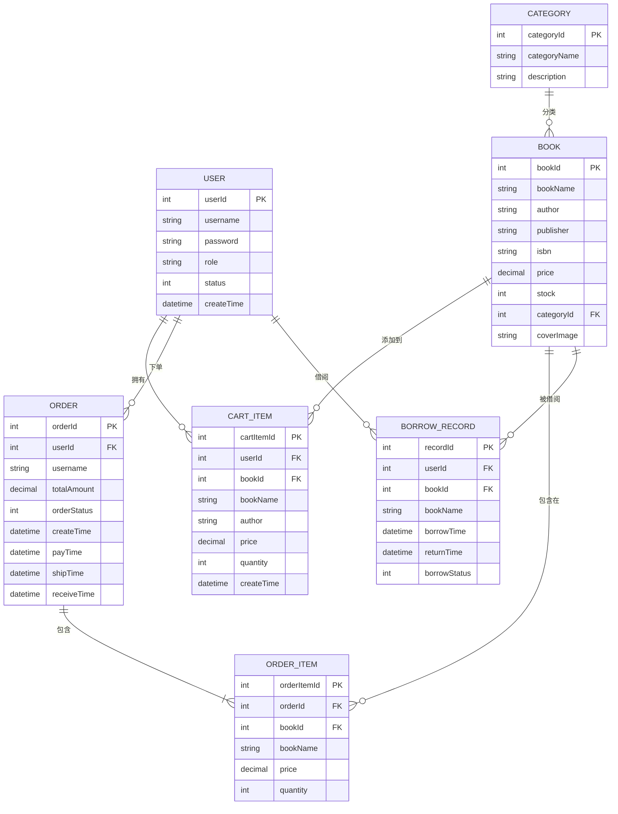

# 图书管理系统 - 前端E-R图

## 实体关系图 (Entity-Relationship Diagram)

## 实体详细说明

### 1. USER (用户表)
存储系统用户信息，包括普通用户和管理员

**字段说明：**
- `userId`: 用户ID（主键）
- `username`: 用户名（唯一）
- `password`: 密码
- `role`: 角色（admin/user）
- `status`: 状态（1启用/0禁用）
- `createTime`: 注册时间

### 2. CATEGORY (图书分类表)
存储图书的分类信息

**字段说明：**
- `categoryId`: 分类ID（主键）
- `categoryName`: 分类名称
- `description`: 分类描述

### 3. BOOK (图书表)
存储图书的基本信息

**字段说明：**
- `bookId`: 图书ID（主键）
- `bookName`: 书名
- `author`: 作者
- `publisher`: 出版社
- `isbn`: ISBN编号
- `price`: 价格
- `stock`: 库存数量
- `categoryId`: 分类ID（外键，关联CATEGORY表）
- `coverImage`: 封面图片路径

### 4. CART_ITEM (购物车项表)
存储用户的购物车数据

**字段说明：**
- `cartItemId`: 购物车项ID（主键）
- `userId`: 用户ID（外键，关联USER表）
- `bookId`: 图书ID（外键，关联BOOK表）
- `bookName`: 书名（冗余字段，方便显示）
- `author`: 作者（冗余字段）
- `price`: 价格（快照，防止后续价格变动影响购物车）
- `quantity`: 数量
- `createTime`: 添加时间

### 5. ORDER (订单表)
存储订单的主信息

**字段说明：**
- `orderId`: 订单ID（主键）
- `userId`: 用户ID（外键，关联USER表）
- `username`: 用户名（冗余字段）
- `totalAmount`: 订单总金额
- `orderStatus`: 订单状态（0未支付/1未发货/2已发货/3已收货）
- `createTime`: 下单时间
- `payTime`: 支付时间
- `shipTime`: 发货时间
- `receiveTime`: 收货时间

### 6. ORDER_ITEM (订单项表)
存储订单中的具体商品项

**字段说明：**
- `orderItemId`: 订单项ID（主键）
- `orderId`: 订单ID（外键，关联ORDER表）
- `bookId`: 图书ID（外键，关联BOOK表）
- `bookName`: 书名（冗余字段）
- `price`: 单价（快照）
- `quantity`: 数量

### 7. BORROW_RECORD (借阅记录表)
存储用户的图书借阅记录

**字段说明：**
- `recordId`: 借阅记录ID（主键）
- `userId`: 用户ID（外键，关联USER表）
- `bookId`: 图书ID（外键，关联BOOK表）
- `bookName`: 书名（冗余字段）
- `borrowTime`: 借阅时间
- `returnTime`: 归还时间
- `borrowStatus`: 借阅状态（0借阅中/1已归还）

## 关系说明

### 一对一关系
- 无

### 一对多关系
1. **USER → CART_ITEM**: 一个用户可以有多个购物车项
2. **USER → ORDER**: 一个用户可以下多个订单
3. **USER → BORROW_RECORD**: 一个用户可以有多条借阅记录
4. **CATEGORY → BOOK**: 一个分类可以包含多本图书
5. **BOOK → CART_ITEM**: 一本图书可以被添加到多个购物车项（不同用户）
6. **BOOK → ORDER_ITEM**: 一本图书可以出现在多个订单项中
7. **BOOK → BORROW_RECORD**: 一本图书可以有多条借阅记录
8. **ORDER → ORDER_ITEM**: 一个订单可以包含多个订单项

### 多对多关系
- 通过中间表实现的多对多关系：
  - USER ↔ BOOK（通过CART_ITEM）
  - USER ↔ BOOK（通过ORDER和ORDER_ITEM）
  - USER ↔ BOOK（通过BORROW_RECORD）

## 业务规则

1. **用户权限控制**
   - 管理员（role='admin'）：可以管理图书、分类、用户、查看所有订单和借阅记录
   - 普通用户（role='user'）：可以浏览图书、加入购物车、下单、借阅图书

2. **订单状态流转**
   - 0（未支付）→ 1（未发货）：用户支付后
   - 1（未发货）→ 2（已发货）：管理员发货后
   - 2（已发货）→ 3（已收货）：用户确认收货后
   - 0（未支付）→ 取消：用户可以取消未支付订单

3. **借阅状态管理**
   - 0（借阅中）：用户借阅图书后
   - 1（已归还）：用户归还图书后

4. **库存管理**
   - 图书借阅时减少库存
   - 图书归还时恢复库存
   - 订单创建时检查库存

5. **数据冗余设计**
   - 购物车项、订单项、借阅记录中都冗余了书名等信息
   - 目的：避免历史数据受图书信息变更的影响
   - 例如：图书价格修改后，不影响已有订单的价格

## 前端API映射

### 用户相关 API
- `/users/all` - 获取所有用户
- `/users?action=login` - 用户登录
- `/users?action=register` - 用户注册
- `/users` - 获取当前用户信息
- `/users/:id` - 根据ID获取用户
- `/users` (PUT) - 更新用户
- `/users/:id` (DELETE) - 删除用户

### 图书相关 API
- `/books` - 获取所有图书
- `/books?keyword=xxx` - 搜索图书
- `/books/:id` - 根据ID获取图书
- `/books` (POST) - 添加图书
- `/books` (PUT) - 更新图书
- `/books/:id` (DELETE) - 删除图书

### 分类相关 API
- `/categories` - 获取所有分类
- `/categories/:id` - 根据ID获取分类
- `/categories` (POST) - 添加分类
- `/categories` (PUT) - 更新分类
- `/categories/:id` (DELETE) - 删除分类

### 购物车相关 API
- `/cart/list` - 获取购物车列表
- `/cart` (POST, action=add) - 添加到购物车
- `/cart/:id` (DELETE) - 从购物车移除
- `/cart` (POST, action=clear) - 清空购物车
- `/cart` (PUT) - 更新购物车数量
- `/cart/total` - 获取购物车总金额

### 订单相关 API
- `/orders/my` - 获取我的订单
- `/orders/all` - 获取所有订单（管理员）
- `/orders` (POST, action=create) - 创建订单
- `/orders` (POST, action=pay) - 支付订单
- `/orders` (POST, action=ship) - 发货（管理员）
- `/orders` (POST, action=receive) - 确认收货
- `/orders` (POST, action=cancel) - 取消订单
- `/orders/:id` (DELETE) - 删除订单

### 借阅相关 API
- `/borrows` - 获取所有借阅记录（管理员）
- `/borrows/my` - 获取我的借阅记录
- `/borrows/current` - 获取当前借阅记录
- `/borrows` (POST, action=borrow) - 借书
- `/borrows` (POST, action=return) - 还书

## 技术栈说明

- **前端框架**: Vue 3
- **HTTP客户端**: Axios
- **路由管理**: Vue Router
- **UI组件**: 原生HTML/CSS
- **数据存储**: LocalStorage（存储token和用户信息）
- **会话管理**: Cookie/Session（后端）
